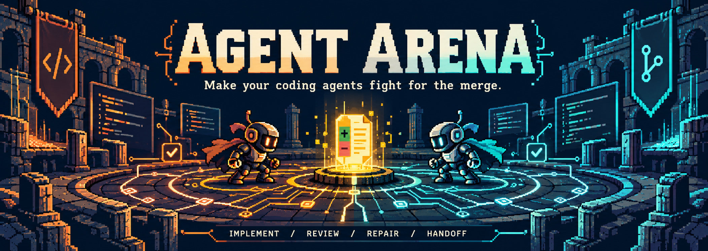
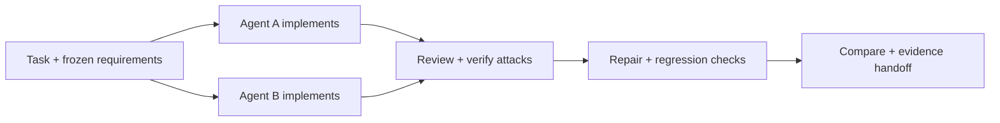

<p align="center">
  
</p>

<p align="center">
  <strong>Two agents. Different perspectives. A patch backed by evidence.</strong><br />
  Automate the implement → review → repair loop, then choose what to merge.
</p>

<p align="center">
  <a href="https://github.com/JDKrasnick/agentarena/actions/workflows/ci.yml"></a>
  <a href="LICENSE"></a>
  <a href="https://nodejs.org/"></a>
  <a href="src/index.ts"></a>
</p>

<p align="center">
  <a href="#quick-start"><strong>Quick start</strong></a> ·
  <a href="#why-i-built-this">Why I built this</a> ·
  <a href="#how-it-works">How it works</a> ·
  <a href="#review-and-handoff">Handoff</a> ·
  <a href="#documentation">Docs</a>
</p>

<p align="center">
  Works with <strong>Codex CLI</strong> · <strong>Claude Code</strong> · <strong>Gemini CLI</strong><br />
  <sub>Local execution · Separate Git worktrees · Bring your authenticated agent CLIs</sub>
</p>

---

Agent Arena gives two coding agents the same repository task, lets them challenge
each other's implementations with reproducible evidence, and gives both a chance
to repair their patches. You get the final implementations, regression tests,
and an explained recommendation when the evidence supports one.

```bash
agent-arena fight "fix the refresh-token race condition" \
  --agents codex,claude --test "npm test"
```

## Why I built this

I kept doing the same thing: ask one agent to implement a change, send it to
another for review, bring the findings back for fixes, rerun checks, and decide
which version to keep. Different agents gave me different perspectives. I was
still doing all the coordination—moving context around, checking claims, and
remembering what had actually been tested.

Agent Arena automates that pipeline. The goal is to get stronger implementations
from independent approaches and adversarial review, then pick the best one the
evidence supports. The handoff is part of the product: **what changed, what broke,
what was repaired, what passed, and what still needs attention**. I want a patch
I can review and evidence I can trace.

## What makes it useful

| Capability                     | What it does                                                                                                                        |
| ------------------------------ | ----------------------------------------------------------------------------------------------------------------------------------- |
| **⚔️ Independent approaches**  | Two implementations from the same frozen task and base commit, each in a separate Git worktree.                                     |
| **🔎 Review with evidence**    | Agents turn concerns into executable attacks. Arena checks reproducibility and whether the expected behavior follows from the task. |
| **🛠️ A chance to repair**      | Accepted failures go back to the contestants. Required checks, active reproducers, and healed-defect regressions run again.         |
| **⚖️ An explained comparison** | Defects and repairs drive the health ledger. An identity-blind judge evaluates semantic validity and can compare patch quality.     |
| **📺 Watch the fight**         | A live desktop observatory, terminal mode, recorded-round replay, and six local themes.                                             |
| **📦 A usable handoff**        | Final patches, a check matrix, linked logs, an HTML evidence dossier, and explicit human acceptance before apply.                   |

## Quick start

**You need:** macOS or Linux, Node.js 22+, Git, and installed, authenticated CLIs
for your selected providers. Use a clean target repository with a passing test
command. The current adapters are Codex CLI, Claude Code, and Gemini CLI.

### 1. Install from source

```bash
git clone https://github.com/JDKrasnick/agentarena.git
cd agentarena
npm ci
npm run build
npm link
```

### 2. Run a fight in your repository

```bash
cd /path/to/your/repository
agent-arena fight "fix repeated whitespace in generated slugs" \
  --agents codex,claude \
  --permissions confirm \
  --test "npm test"
```

Arena presents a permission plan before starting battle agents. A dedicated
Electron window opens by default; use `--no-window` for terminal output, or
`--display plain` for logs and automation.

### 3. Review the result

```bash
agent-arena review <run-id>
agent-arena inspect <run-id> --agent a --view diff
agent-arena accept <run-id> --selection recommended --apply
```

Patch commands use contestant IDs `a` and `b`, as shown by `review`. If there is
no recommendation, inspect the eligible choices and select one explicitly with
`agent-arena accept <run-id> --agent <contestant>`.

> [!NOTE]
> Try the interface without provider credentials: `npm run demo:window` for the
> desktop observatory or `npm run demo:dashboard` for the terminal.

> [!IMPORTANT]
> Agent code and tests run with your OS account's permissions. Git worktrees
> isolate patches; they are not a hostile-code sandbox. Use a sanitized account
> or external container when stronger isolation is needed. [Security model →](docs/SECURITY.md)

## How it works



Fights run **one to five attack–repair rounds**, scaled to the task. Each agent
can submit up to three ranked attacks per round. Mechanical confirmation
requires an attack to pass twice on its author and fail twice on its target.
The judge checks claims against frozen requirements; fallback judgments are
labeled separately from mechanical evidence.

Surviving the arena adds evidence, not a correctness guarantee. A run can finish
with a winner, a draw, a non-discriminating comparison, or an inconclusive result.
Arena preserves uncertainty when the evidence cannot justify a winner.

<details>
<summary><strong>Scoring, coverage, and quality recommendations</strong></summary>

Both contestants start at 100 HP. Confirmed Critical, High, Medium, and Low
defects deal 50, 30, 15, and 5 HP. Missed attacks incur rank-based recoil of 5,
10, or 15 HP. A distinct defect scores once; a verified repair heals its active
damage, while recoil remains permanent.

Competitive results follow the health ledger. A fresh identity-blind quality
comparison may break a tie when HP and active defect damage are both equal.
For a fully covered duel or catch-up, when both final patches pass required
checks, have equal active defect damage, and no still-valid contestant attack
distinguishes them, Arena reports a **non-discriminating** result. A separate
quality comparison may recommend an implementation without declaring a champion.

Incomplete required attack coverage leaves the result provisional and blocks
ordinary review and apply. The user must resolve the exact coverage assessment
as reduced-confidence or inconclusive. See the [full rules](docs/MVP.md#product-rules).

</details>

## Battle modes

| Mode         | Start with                                            | Use it to                                                                                  |
| ------------ | ----------------------------------------------------- | ------------------------------------------------------------------------------------------ |
| **Duel**     | A task and two fresh implementations                  | Compare independent approaches and challenge both patches.                                 |
| **Catch-up** | An existing PR and a challenger working from its base | See whether another approach can improve on the incumbent without seeing its diff.         |
| **Siege**    | An existing PR, a defender, and a test-only attacker  | Find and repair defects in the defender's patch. Only the defender's patch is deliverable. |

<details>
<summary><strong>Commands for PR battles and model comparisons</strong></summary>

```bash
# Catch-up
agent-arena fight "fix issue #241" --pr 87 --incumbent-from-pr \
  --incumbent claude --challenger codex --test "npm test"

# Siege
agent-arena defend --pr 87 \
  --attacker codex --defender claude --test "npm test"

# Same provider, different models: replace these with supported model IDs.
agent-arena fight "fix issue #241" \
  --agents codex,codex --models model-a,model-b --test "npm test"
```

Models follow contestant order; omitting `--models` uses each CLI's configured
default. `--incumbent` can be omitted only when PR attribution is confirmed.
On its own, `--pr` supplies requirements context. Use `--base-from-pr 87`
explicitly when both contestants should start from that PR's head.

</details>

## Review and handoff

Every run saves its evidence under `.agent-arena/runs/<run-id>/`:

| Artifact                     | What it gives you                                                                     |
| ---------------------------- | ------------------------------------------------------------------------------------- |
| **`BATTLE.html`**            | A clickable evidence dossier with results, checks, defects, repairs, and linked logs. |
| **`BATTLE.md`**              | The text replay and review handoff.                                                   |
| **Final patches**            | The exact implementations available for review and acceptance.                        |
| **`BATTLE.svg`**             | A deterministic visual replay to share.                                               |
| **Run data and transcripts** | Source snapshots, prompts, redacted output, and event history for deeper inspection.  |

Acceptance binds to the exact patch digest and base commit. Applying an accepted
patch checks the clean tree and patch applicability, without committing it.
Non-interactive acceptance requires the full displayed `--confirm-sha256`.

GitHub delivery is **separately authorized and disabled by default**. Accepting
a patch does not authorize a commit, push, PR, or merge.

<details>
<summary><strong>Resume and worktree cleanup</strong></summary>

```bash
agent-arena resume <run-id> --display console
agent-arena cleanup-worktrees <run-id>
```

Resume continues from a sealed boundary. Material runtime drift requires
approval bound to the displayed report hash via `--approve-drift <report-sha256>`.
Use `fight --keep-worktrees` to retain successfully created worktrees for debugging,
then clean them up with the command above.

</details>

## Configuration

Save repeatable settings in `agent-arena.yaml`. Explicit CLI flags override YAML.

```yaml
test: npm test
bootstrap: auto
agents: [codex, claude]
judge: codex
effort: auto
permissions:
  default: confirm
  deny: [production_credentials, production_deploy]
delivery:
  enabled: false
  merge_enabled: false
```

`bootstrap: auto` selects a locked dependency install. `effort: auto` scales
rounds to the task; `--rounds 1..5` requests an exact count with medium timings
and cannot be combined with explicit `--effort auto`.

MCP readiness checks run before battle agents start. Arena shows the final
policy and excludes failed servers; `--review-mcp` enables per-server review
and provider-managed authentication retries.

See the [configuration reference](docs/MVP.md#configuration) for sources,
models, limits, and integration profiles.

## Documentation

|                                            |                                                             |
| ------------------------------------------ | ----------------------------------------------------------- |
| [Product](PRODUCT.md)                      | Product behavior, architecture, and design direction.       |
| [MVP specification](docs/MVP.md)           | Scope, evidence rules, configuration, and failure behavior. |
| [Artifacts](docs/ARTIFACTS.md)             | Immutable run evidence and post-fight records.              |
| [Security](docs/SECURITY.md)               | Execution boundaries and review/delivery authorization.     |
| [Live validation](docs/LIVE_VALIDATION.md) | Manual release checks using real providers.                 |

<details>
<summary><strong>Embedding Arena in a chat or IDE host</strong></summary>

The TypeScript library exports `reviewRun`, `inspectPatch`,
`recordReviewDecision`, and `applyAcceptedPatch`. Delivery has separate planning,
decision, execution, and status operations. The host maps authenticated user
actions to strict schemas; the core does not parse conversational approval or
store raw chat text or attestation tokens.

</details>

## Development

```bash
npm ci
npm run format:check
npm run lint
npm run typecheck
npm test
npm run build
```

Focused checks: `test:unit`, `test:integration`, and `test:smoke`. CI uses fake
providers and temporary repositories, without network or paid provider sessions.
Live checks are manual; `npm run test:live` skips unless `AGENT_ARENA_LIVE=1`.

Run a real Codex-only stateful duel in a fresh local repository:

```bash
AGENT_ARENA_LIVE=1 npm run test:live:codex-stateful -- --case outbox \
  --models gpt-6-luna,gpt-6.1-sol --require-signal
```

Use `--case cache` for stale-load, TTL, and LRU coverage. Model IDs are optional
and must be available to your Codex account. These checks use real providers,
two fixed rounds, and explicit per-stage time limits; they expose no MCP
servers and perform no GitHub writes. Results and disposable repositories stay
under `.context/live-stateful/`. `--require-signal` fails the check if no damage,
healing, or recoil was recorded; it never changes scoring or forces an attack.
Without `AGENT_ARENA_LIVE=1`, the command skips before building or starting a
provider session.
Found a bug or have an idea? [Open an issue](https://github.com/JDKrasnick/agentarena/issues).
For a change, include the problem, approach, and validation in your pull request.

---

<p align="center">
  Built for the implement–review loop. Made to leave evidence.<br />
  <a href="LICENSE">MIT licensed</a>
</p>
